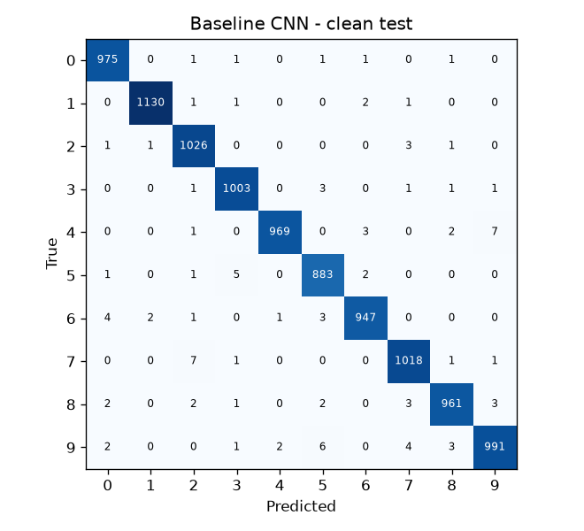
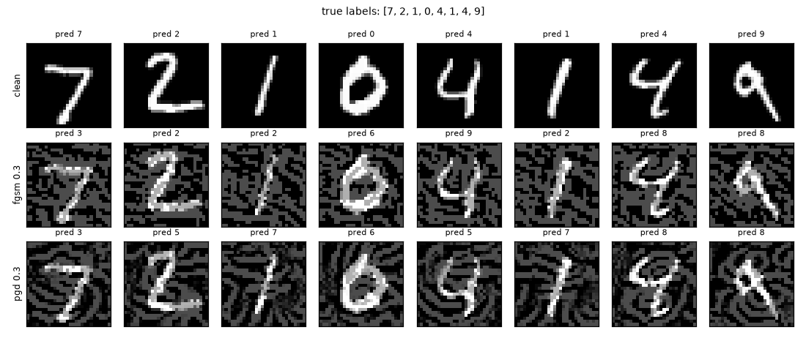
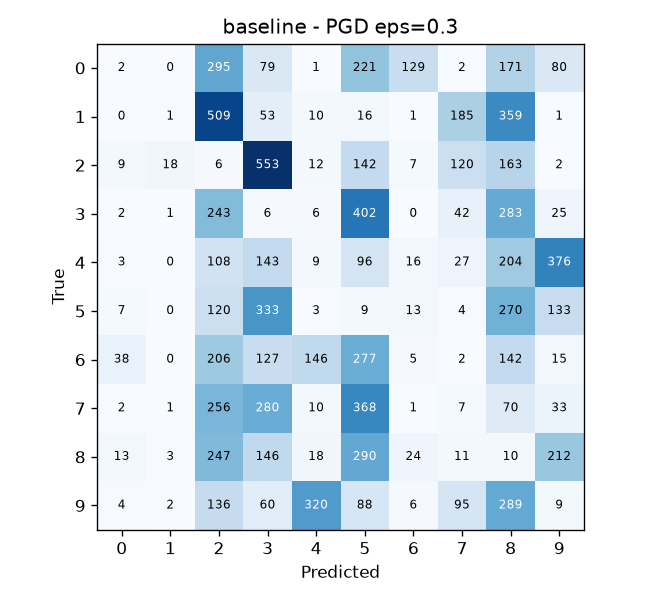
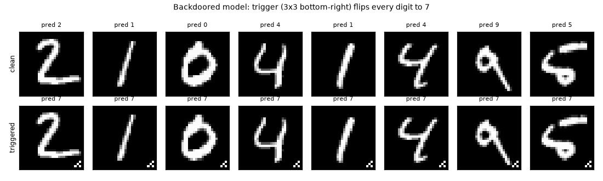
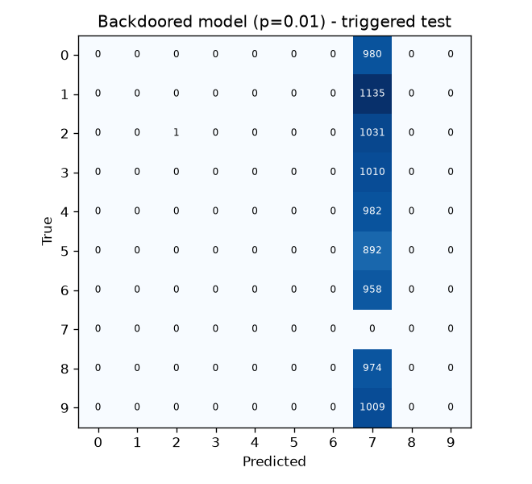
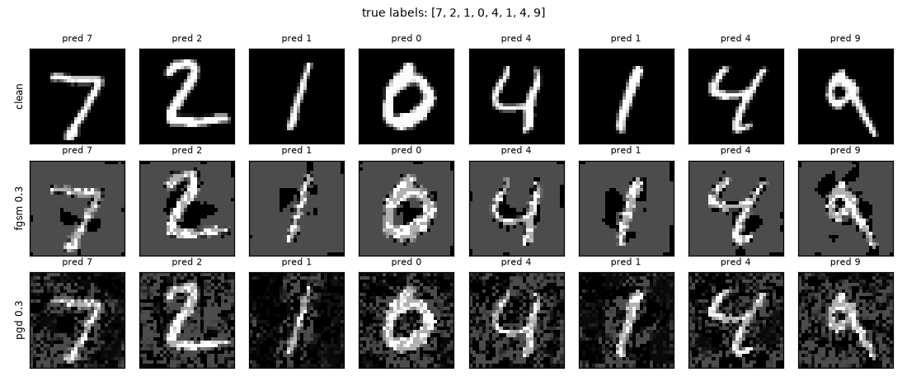
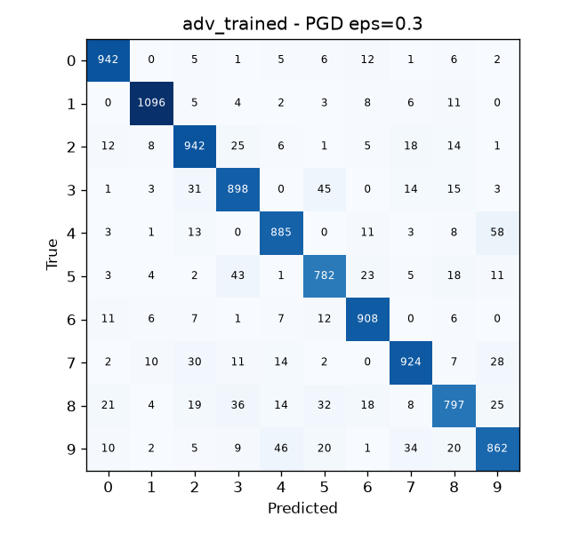

# Secure AI Systems: Red and Blue Teaming an MNIST Classifier

**Team:** _<member 1 name, roll no.>_, _<member 2 name, roll no.>_

**Repositories**
- CNN implementation (MNIST image classification): https://github.com/Stroustrup-Ritchie/SSE-Assignment (`src/common.py`, `src/train.py`)
- Attack code and adversarial / poisoned datasets: https://github.com/Stroustrup-Ritchie/SSE-Assignment (`src/attacks/evasion.py`, `src/attacks/poison.py`; generated datasets in `data/adversarial/`, `data/poisoned/`)

Everything here can be reproduced with `bash run_all.sh`; the raw numbers are in `results/*.json`.

---

## 1. System under test

| Item | Value |
|---|---|
| Framework | PyTorch 2.14.1, torchvision 0.29.1, IBM Adversarial Robustness Toolbox (ART) 1.20.1 |
| Data | MNIST: 60,000 train / 10,000 test, 28x28 grayscale, pixels scaled to [0,1] |
| Model | Conv(1→32, 3x3) → ReLU → Conv(32→64, 3x3) → ReLU → MaxPool 2 → Dropout 0.25 → FC 9216→128 → ReLU → Dropout 0.5 → FC 128→10 (1.2 M parameters) |
| Training | Adam, lr 1e-3, StepLR (x0.3 halfway), batch 128, 6 epochs, seed 42 |
| Hardware | Apple M2 (8 GB), PyTorch MPS backend; single-image latency measured on CPU |

---

## 2. Baseline performance on the clean test set

| Metric | Value |
|---|---|
| Test accuracy | **99.03%** (97 errors / 10,000) |
| Test loss (mean cross-entropy) | 0.0295 |
| Macro precision / recall / F1 | 0.990 / 0.990 / 0.990 |
| Per-class F1 | lowest: 9 (0.985), 5 (0.987); highest: 1 (0.997), 0 (0.992) |
| Most common confusions | 4→9 (7), 7→2 (7), 9→5 (6), 5→3 (5) |
| Inference time, batched (MPS, batch 1000) | 23.2 ms per batch = **0.023 ms / image** |
| Inference time, single image (CPU, median of 200) | **0.196 ms** |
| Training time | 6 epochs x ~8 s on MPS |

Training curve (loss / train acc per epoch): 0.303/90.8% → 0.104/97.0% → 0.078/97.7% → 0.056/98.3% → 0.048/98.6% → 0.043/98.7%.



Full per-class report: `results/baseline_metrics.json`.

---

## 3. Threat model

### 3.1 Deployment we are modelling

On its own, the lab model is a script. For threat modelling we assume the realistic version:
a **handwritten-digit reading service**, e.g. reading amounts and account numbers on scanned
bank cheques or exam mark-sheets.

```
 [Data contributors / public MNIST mirror] --(1)--> [Data ingestion + preprocessing] --> [Training job]
                                                                                              |
                                                                                       (2) model file
                                                                                              v
 [Client app / scanner] --(3) image--> [Inference API] <--- load --- [Model registry / disk]
                                     |                    \--(4) label + confidence--> [Downstream system: payment / grading]
                                     \--> logs
```
Trust boundaries: (1) untrusted data enters the pipeline; (2) a model artifact crosses from
training into serving; (3) untrusted end-user input reaches the model; (4) model output drives
a business decision.

### 3.2 Attacker model

| | Evasion attacker (ML01) | Poisoning attacker (ML02) |
|---|---|---|
| **Goal** | Make a specific input be misread (e.g. "1" read as "7" on a cheque); or untargeted failure | Plant a hidden trigger: any digit carrying the trigger is read as the attacker's chosen digit (7), while normal accuracy stays intact so nobody notices |
| **Knowledge** | White-box: architecture and weights, which is the worst case (Kerckhoffs). Also a black-box transfer setting, where samples crafted on a surrogate model are replayed against the defended model | Knows the data format and labels; does **not** need the weights |
| **Capability** | Changes each input pixel by at most ε in L∞ (ε ∈ {0.1, 0.2, 0.3}); cannot touch the model or training | Controls a small fraction (0.1%-5%) of training samples: images and labels. Cannot change code, hyper-parameters or the test set |
| **Access** | Query access to the inference API (plus gradients in the white-box case) | Write access to a data source the pipeline ingests, e.g. a crowd-sourced labelling queue or a compromised dataset mirror |
| **Out of scope** | Physical-world attacks, unrestricted perturbations | Changing training code, insider with full infra access |

### 3.3 STRIDE (ML interpretation) mapped to OWASP ML Top 10 (2023)

| STRIDE | Threat in this system | Where (DFD) | OWASP ML | Status in this project |
|---|---|---|---|---|
| **S**poofing | Attacker poses as a legitimate data contributor or dataset mirror and supplies crafted training data; a forged model file is presented as the official one | (1), (2) | ML02, ML06 | Model files are integrity-checked (SHA-256 manifest). Data provenance is only partly covered: torchvision checks MD5 of the MNIST archives |
| **T**ampering | (a) adversarial perturbation of inputs at inference; (b) poisoned / back-doored training data; (c) modified weights; (d) altered outputs on the way to the downstream system | (3), (1), (2), (4) | ML01, ML02, ML10, ML09 | (a) and (b) attacked and defended (Sections 5-6); (c) mitigated by safetensors + hash check; (d) out of scope (would need signed/authenticated responses) |
| **R**epudiation | No record of which data samples or contributors went into a model version, or which model version produced a decision; a poisoner cannot be traced | (1), (4) | ML02, ML08 | `models/manifest.json` records hash and training metadata per model; per-sample data lineage is a recommendation |
| **I**nformation disclosure | Model inversion reconstructs representative training digits; membership inference reveals whether a person's handwriting was in the training set; returning full softmax confidences makes both easier, and lets an attacker clone the model | (4) | ML03, ML04, ML05 | Analysed only (LINDDUN, 3.5). Mitigation: return top-1 label only, rate-limit, DP-SGD for real data |
| **D**enial of service | Query flooding of the API; availability poisoning (e.g. random label flipping) that degrades accuracy for everyone | (3), (1) | ML02, ML08 | Not implemented (needs API rate limiting); availability poisoning is discussed in Conclusions |
| **E**levation of privilege | Loading a pickle-based checkpoint (`torch.load`) executes arbitrary code from a malicious model file, so a model swap becomes remote code execution on the training/serving host; a successful evasion also "elevates" a forged cheque to an approved one | (2), (4) | ML06, ML01 | Fixed (SAST finding B614, Section 4) |

**OWASP ML Top 10 risks exercised in this project:** ML01 Input Manipulation (FGSM, PGD) and
ML02 Data Poisoning (backdoor). ML06 AI Supply Chain is addressed by the SAST/SCA fixes. ML03,
ML04, ML05, ML09 and ML10 are analysed but not attacked. ML07 Transfer Learning does not apply
because the model is trained from scratch.

### 3.4 Why these attacks were chosen

* **ML01 Input Manipulation (FGSM + PGD).** This is the most direct threat to a digit reader: the
  attacker controls the image they submit. FGSM is the classic single-step attack and gives a
  cheap lower bound on vulnerability. PGD is the strongest standard first-order L∞ attack: robustness
  claims are normally made against PGD, and a defense that only survives FGSM is considered
  broken.
* **ML02 Data Poisoning (backdoor).** Real systems retrain on data gathered from outside (users,
  crowd labellers, scraped mirrors). A backdoor is the most dangerous form of poisoning
  because it is *stealthy*: clean-test accuracy, the metric teams monitor, does not move. That makes
  it a good test of whether accuracy-based monitoring is enough. (It is a stronger choice than
  random label flipping, which visibly lowers accuracy.)

### 3.5 LINDDUN: privacy threats for a real-world version

MNIST digits are anonymous, but a deployed system would process handwriting from identifiable
people (cheques, forms, exam sheets). Handwriting is a behavioural biometric.

| LINDDUN category | Threat | Mitigation |
|---|---|---|
| **L**inking | Handwriting style links different documents (and stored training images) to the same writer across contexts | Store only the crop needed for recognition; do not keep a writer ID with training images; aggregate data |
| **I**dentifying | Scans contain names, signatures and account numbers; handwriting itself can re-identify a writer | Crop to the digit field before storage; strip metadata; access control on raw scans |
| **N**on-repudiation | Detailed inference logs (image + timestamp + account) prove that a person wrote or submitted a document, which is unwanted in some contexts (e.g. anonymous surveys) | Log minimisation, retention limits, pseudonymous request IDs |
| **D**etecting | Membership inference (ML04) reveals whether someone's handwriting was used for training | Return labels, not confidences; DP-SGD training; regularisation (dropout already helps a little) |
| **D**ata disclosure | Model inversion (ML03) or a stolen model/dataset leaks writers' samples; poisoned/adversarial datasets kept on disk are also sensitive | Encrypt data at rest, least-privilege access, no raw-data export, ship weights only (no data inside the artifact) |
| **U**nawareness | Writers do not know their handwriting is kept and reused to train models | Privacy notice at collection, opt-out from training use |
| **N**on-compliance | Re-use of personal data for training without a lawful basis or purpose limitation (GDPR; India's DPDP Act 2023) | Consent / lawful basis recorded per sample, retention schedule, DPIA before deployment |

---

## 4. SAST: findings and fixes

Tools from the OWASP source-code-analysis tools list:
- **Bandit 1.8.6**, a Python AST security linter.
- **Semgrep 1.136.0** with the `p/python`, `p/bandit`, `p/trailofbits`, `p/owasp-top-ten`, `p/secrets` and `p/default` rulesets.
- **pip-audit**, a dependency check (software composition analysis, SCA) against the PyPI/OSV advisory databases.

The first version of the code was committed (`e35adba`) and scanned. The fixes were then applied and everything was re-scanned. Raw reports are in `results/sast/*_before.json` / `*_after.json`.

### 4.1 Findings (before)

| # | Tool / rule | Location | Severity | Finding |
|---|---|---|---|---|
| 1 | Bandit **B614** `pytorch_load` | `src/common.py:229` (`load_model`) | Medium (High confidence) | `torch.load(path)` unpickles the checkpoint: a malicious model file runs arbitrary code when loaded |
| 2 | Semgrep `trailofbits.python.pickles-in-pytorch` | `src/common.py:229` | ERROR | Same issue as #1, flagged independently |
| 3 | Semgrep `trailofbits.python.pickles-in-pytorch` | `src/common.py:223` (`save_model`) | ERROR | `torch.save` writes a pickle-based checkpoint (with a metadata dict inside), which forces consumers to unpickle |
| 4 | Semgrep `trailofbits.python.automatic-memory-pinning` | `src/common.py:76` (`DataLoader`) | WARNING | Suggests `pin_memory=True` for efficiency |
| 5 | pip-audit (SCA) | `requirements.txt` (unpinned) on Python 3.9 | 63 known CVEs/advisories | torch 2.8.0 (8, e.g. PYSEC-2025-203..206), pillow 11.3.0 (52), filelock 3.19.1 (2), fsspec 2025.10.0 (1). The fixed versions need Python >= 3.10, and Python 3.9 itself is end-of-life |
| 6 | Manual review (found while fixing #1) | `load_model(name)` | Medium | The model name is joined into a path unchecked, so `--model ../../x` reads files outside `models/` (path traversal) |

### 4.2 Fixes

| # | Fix |
|---|---|
| 1-3 | Weights are saved with **safetensors** (a pure tensor format with no pickle, so loading cannot execute code). Training metadata goes into the safetensors header and `models/manifest.json`. |
| 1-3 (defence in depth) | `save_model` records the **SHA-256** of every model file in `models/manifest.json`. `load_model` refuses to load a file whose hash does not match, which detects tampered or swapped models (STRIDE Tampering / OWASP ML06/ML10). |
| 4 | **Triaged as not a security issue**: it is a performance hint, and pinned memory is not supported on the MPS backend. Suppressed with a documented `# nosemgrep` comment. |
| 5 | Moved to **Python 3.13**. **Every dependency is pinned exactly** in `requirements.txt` (torch 2.14.1, pillow 13.0.0, filelock 4.2.4, fsspec 2026.9.0, ...), which also prevents silent upgrades or typosquats at install time. |
| 6 | `_model_path()` accepts only a bare file name and always resolves inside `models/`. |
| — | `np.load` is used with its safe default (`allow_pickle=False`) for all `.npz` datasets. |

### 4.3 After

| Tool | Before | After |
|---|---|---|
| Bandit | 1 (Medium) | **0** (final code, 684 LoC; 0 with both 1.8.6 and 1.9.4) |
| Semgrep (6 rulesets) | 3 (2 ERROR, 1 WARNING) | **0** (with both 1.136.0 and 1.182.1) |
| pip-audit 2.10.1 | 63 vulnerabilities in 4 packages | **0** ("No known vulnerabilities found") |

We also checked that the fixes work. `load_model("../../etc/passwd")` raises `ValueError: invalid model name`.
Flipping a single bit of `baseline.safetensors` makes `load_model` fail with `integrity check failed`.
Restoring the file loads normally again.

All experiment results below were produced **after** the fixes, on the patched environment.

---

## 5. Red team: attacks and the model's performance on adversarial / poisoned data

### 5.1 Attack 1 and 2: FGSM and PGD evasion (OWASP **ML01 Input Manipulation**)

* **Tool:** IBM ART 1.20.1 (`FastGradientMethod`, `ProjectedGradientDescent`) wrapping the
  PyTorch model in a `PyTorchClassifier`, with clip values [0,1].
* **Setting:** white-box, untargeted, L∞ budget ε ∈ {0.1, 0.2, 0.3} (pixel scale 0-1). PGD uses
  20 iterations, step ε/8, and 1 random start. All 10,000 test images are attacked.
* **Why ML01:** this is the input the attacker controls in the deployed system (Section 3.4).
* **Output datasets:** `data/adversarial/{fgsm,pgd}_eps{0.1,0.2,0.3}_baseline.npz` (generated by
  `src/attacks/evasion.py`).

| Test set | Accuracy | Loss | Macro F1 | Mean L2 of perturbation |
|---|---|---|---|---|
| Clean | 99.03% | 0.030 | 0.990 | 0 |
| FGSM ε=0.1 | 90.53% | 0.277 | 0.905 | 2.13 |
| FGSM ε=0.2 | 45.52% | 1.862 | 0.462 | 4.23 |
| FGSM ε=0.3 | 14.82% | 4.350 | 0.142 | 6.30 |
| PGD ε=0.1 | 80.28% | 0.621 | 0.804 | 2.04 |
| PGD ε=0.2 | **2.06%** | 8.096 | 0.023 | 3.93 |
| PGD ε=0.3 | **0.64%** | 20.376 | 0.007 | 5.75 |

The model is 99% accurate yet almost completely broken by PGD at ε=0.2: digits that a human
still reads easily (figure below) are misclassified 98% of the time. PGD is much stronger than
single-step FGSM at the same budget. At ε=0.3, FGSM's single large step overshoots, while PGD's
iterative steps follow the loss surface.




### 5.2 Attack 3: Backdoor data poisoning (OWASP **ML02 Data Poisoning**)

* **Tool:** ART `PoisoningAttackBackdoor` with the `add_pattern_bd` trigger, a 3x3 checkerboard in
  the bottom-right corner.
* **Method:** pick p% of the 60,000 training images from classes ≠ 7, stamp the trigger, relabel
  them **7**, then train a fresh model with the unchanged training code (6 epochs).
* **Metrics:** clean test accuracy (what a team normally monitors), plus the *triggered test set*:
  all 8,972 non-7 test images with the trigger. On that set we report accuracy against the true
  label and the **attack success rate (ASR)**, the fraction classified as 7.
* **Why ML02:** this is the realistic threat for a model that is retrained on external data, and it is
  invisible to accuracy monitoring (Section 3.4).
* **Output datasets:** `data/poisoned/backdoor_train_p{0.001,0.005,0.01,0.05}.npz` (each includes the
  indices of the poisoned rows) and `data/poisoned/triggered_test.npz`.

| Poison rate | # poisoned images | Clean test acc | Triggered test acc (true label) | Attack success rate |
|---|---|---|---|---|
| 0 (clean baseline) | 0 | 99.03% | 99.02% | 0.13% |
| 0.1% | 60 | 98.99% | 0.72% | **99.28%** |
| 0.5% | 300 | 98.90% | 0.02% | 99.98% |
| 1% | 600 | 99.06% | 0.01% | **99.99%** |
| 5% | 3,000 | 98.85% | 0.00% | 100.00% |

**Just 60 poisoned images (0.1%) give a 99.3% backdoor**, and clean accuracy stays within ±0.2
points of the baseline at every rate. A team looking only at test accuracy would ship this model.




---

## 6. Blue team: defenses and metrics vs the baseline

| # | Control | Against | Where in the pipeline |
|---|---|---|---|
| D1 | **PGD adversarial training**: every batch is 50% clean + 50% PGD samples (ε=0.3, 10 steps, step 0.075, random start) generated on the fly against the current weights; 8 epochs | ML01 | Training |
| D2 | **Feature squeezing** (Xu et al. 2018): 1-bit depth reduction + 2x2 median filter, used (a) as a *detector* that rejects inputs whose prediction changes too much under squeezing (threshold fixed at 5% FPR on 5,000 held-out clean training images) and (b) as an *input transformation* (classify the 1-bit squeezed image) | ML01 | Inference input validation |
| D3 | **Activation clustering** (Chen et al. 2018): per class, cluster the penultimate-layer activations of the untrusted training set, remove the small, well-separated cluster, and retrain | ML02 | Data sanitisation before training |
| D4 | **Integrity and supply-chain controls** from SAST: safetensors, SHA-256 manifest, pinned and patched dependencies | ML06 / ML10 | Build and deployment |

### 6.1 D1: Adversarial training (adversarial samples + clean data)

**Clean performance vs baseline**

| Model | Clean acc | Loss | Macro F1 | Lowest per-class F1 | Batched ms/image (MPS) | Single image CPU (ms) | Training time |
|---|---|---|---|---|---|---|---|
| Baseline | 99.03% | 0.030 | 0.990 | 9: 0.985 | 0.023 | 0.196 | ~50 s |
| Adversarially trained | 98.45% | 0.050 | 0.984 | 9: 0.972 | 0.029 | 0.209 | ~250 s (5x) |

The architecture is identical, so inference cost is unchanged; the small timing differences are
measurement noise. The cost of the defense is **-0.58 points of clean accuracy and ~5x training
time**.

**Robustness vs baseline.** "White-box, adaptive" means new FGSM/PGD samples are generated with
ART against the *defended* model itself, the honest evaluation. "Transfer" replays the
adversarial test sets that were crafted on the baseline (Section 5.1).

| Attack | ε | Baseline | Adv-trained, white-box (adaptive) | Adv-trained, transfer from baseline |
|---|---|---|---|---|
| FGSM | 0.1 | 90.53% | **97.61%** | 97.86% |
| FGSM | 0.2 | 45.52% | **96.10%** | 96.71% |
| FGSM | 0.3 | 14.82% | **94.06%** | 94.33% |
| PGD | 0.1 | 80.28% | **97.34%** | 97.86% |
| PGD | 0.2 | 2.06% | **95.04%** | 96.89% |
| PGD | 0.3 | 0.64% | **90.36%** | 95.00% |

Under the strongest attack (PGD ε=0.3), accuracy goes from 0.64% to 90.36%. Losses drop by
one to two orders of magnitude (PGD ε=0.3: 20.4 → 0.26). Transfer attacks are weaker than white-box
ones, as expected, so we report the white-box column as the robustness figure.




### 6.2 D2: Feature squeezing

**As a detector** (threshold calibrated on clean data only; clean-test false-positive rate 5.9% for the baseline,
5.8% for the adv-trained model). "Rejected-or-correct" is the fraction of attack inputs that are
either rejected or still classified correctly, which is what matters for the system.

| Attack (crafted against that model) | Baseline: detection rate | Baseline: rejected-or-correct | Adv-trained: detection rate | Adv-trained: rejected-or-correct |
|---|---|---|---|---|
| FGSM ε=0.1 | 33.3% | 99.9% | 10.9% | 99.7% |
| FGSM ε=0.2 | 84.8% | 99.2% | 14.7% | 99.4% |
| FGSM ε=0.3 | 93.6% | 98.0% | 20.2% | 98.8% |
| PGD ε=0.1 | 50.1% | 99.9% | 11.6% | 99.8% |
| PGD ε=0.2 | 98.4% | 98.6% | 17.0% | 99.4% |
| PGD ε=0.3 | 95.8% | 96.2% | 27.2% | 98.9% |

On the baseline, the detector catches 96-98% of the strong PGD attacks. On the adv-trained model
the detection rate is low because most attacks no longer change the prediction, so there is little
for the detector to see. Combined, at least 98.9% of inputs are handled.

**As an input transformation** (classify the 1-bit squeezed image). Because the samples above
were not crafted with the squeezer in mind, we also ran an **adaptive attack** on the full
squeeze-then-classify pipeline: 40-step PGD with BPDA (Athalye et al. 2018) through the rounding.

| Pipeline | Clean | PGD ε=0.3 (non-adaptive) | BPDA-PGD ε=0.1 | ε=0.2 | ε=0.3 | ε=0.4 |
|---|---|---|---|---|---|---|
| Baseline (no defense) | 99.03% | 0.64% | - | - | - | - |
| Baseline + 1-bit squeeze | 98.72% | 86.43% | 96.99% | 92.84% | 81.48% | **51.87%** |
| Adv-trained (no squeeze) | 98.45% | 90.36% | - | - | - | - |
| Adv-trained + 1-bit squeeze | 98.41% | 93.73% | 97.72% | 96.65% | **95.06%** | **90.95%** |

Binarisation is unusually effective on MNIST: background pixels are exactly 0, so an attacker
needs a perturbation larger than 0.5 to flip them. It still degrades quickly once ε approaches 0.5
(baseline + squeeze: 51.9% at ε=0.4). It would also not carry over to natural images. The
**layered** configuration, adversarial training plus squeezing, is the most robust one we
measured: 95.1% under an adaptive attack at ε=0.3, at a clean-accuracy cost of 0.6 points.

### 6.3 D3: Activation clustering against the backdoor (1% poisoning)

The defender does not know which samples, which class or which trigger. They have the
untrusted training set and the model trained on it.

| Variant | Class(es) flagged | Samples removed | Poison found | Precision | Recall | Clean samples removed |
|---|---|---|---|---|---|---|
| ICA → 10 dims, 2-means (paper default) | 1 (wrong) | 2,160 | 0 / 600 | 0.00 | 0.00 | 2,160 |
| **PCA → 10 dims, 2-means** | **7 (correct)** | 598 | **598 / 600** | **1.00** | **0.997** | **0** |

The decision rule was the same in both runs, fixed before seeing the results: smaller
cluster < 35% of the class and silhouette > 0.10. Our first configuration (ICA, as in the paper and in
ART's `ActivationDefence`) **failed completely**. It split every class roughly in half by
handwriting style and wrongly flagged class 1. Analysis showed that the trigger is the *dominant
variance* direction of the poisoned class 7. PCA keeps that direction, while ICA's
independence objective does not. With PCA, class 7 splits into a cluster of 6,267 images (only 2 of them
poisoned) and a cluster of 598 images, all poisoned (silhouette 0.55, against 0.17-0.26 for the clean classes).

| Model | Clean test acc | Triggered test acc | Attack success rate |
|---|---|---|---|
| Clean baseline (reference) | 99.03% | 99.02% | 0.13% |
| Backdoored, no defense | 99.06% | 0.01% | 99.99% |
| Retrained after ICA filtering | 98.95% | 0.00% | 100.00% |
| **Retrained after PCA filtering** | **98.97%** | **98.94%** | **0.19%** |

After PCA-based filtering and retraining, the backdoor is gone. The attack success rate falls from 99.99% to
0.19%, close to the clean model's 0.13% base rate. Clean accuracy is unchanged (98.97% vs 99.03% baseline).
The 2 poisoned samples that survived were not enough to re-install the trigger.

### 6.4 Summary: baseline vs defended

| Scenario | Undefended | Defended | Defense |
|---|---|---|---|
| Clean test accuracy | 99.03% | 98.45% (D1) / 98.41% (D1+D2) | D1, D2 |
| PGD ε=0.3, white-box | 0.64% | 90.36% (D1) | D1 |
| PGD ε=0.3, adaptive through squeezer | - | 95.06% (D1+D2) | D1+D2 |
| PGD ε=0.3 inputs rejected or correct | 0.64% | 98.9% (D1+D2 detector) | D1+D2 |
| Backdoor ASR, 1% poison | 99.99% | 0.19% | D3 |
| Clean acc of backdoor-filtered model | 99.06% | 98.97% | D3 |
| Malicious model file (pickle RCE) | code runs on load | rejected (hash mismatch / no pickle) | D4 |

---

## 7. Conclusions and observations

1. **High accuracy is not security.** A 99% model fell to 2% accuracy under an attack that
   changes each pixel by at most 0.2. A 0.1% data poisoning gave a 99% backdoor with no
   visible change in accuracy. Standard evaluation metrics would not have caught either attack.
2. **Evaluate with the strongest and adaptive attacks.** FGSM understated the vulnerability:
   14.8% vs 0.6% at ε=0.3. Transfer attacks overstated the defense: 95.0% vs 90.4%. Squeezing
   looked strong against non-adaptive samples, and the adaptive BPDA attack exposed where it fails
   (ε=0.4). All the figures we report as defense performance are white-box / adaptive.
3. **Adversarial training works, at a cost.** It gave a 90% PGD-robust model (from 0.6%) for -0.6 points of
   clean accuracy and 5x training time. Robustness only holds inside the ε it was trained for.
4. **Defense in depth beats any single control.** Adversarial training plus feature squeezing
   was the strongest combination against adaptive attacks. The detector also adds an operational signal:
   a spike in rejected inputs flags an ongoing attack.
5. **Poisoning defenses need verification, too.** The literature-default activation clustering
   (ICA) silently failed and removed 2,160 clean images. Without ground truth, a team would have
   believed the data was clean. We only caught the failure because we measured ASR after
   retraining. In practice, defenders should keep a small trusted, trigger-free validation set and
   review flagged clusters by eye: the flagged class-7 images visibly carry the patch.
6. **Classic AppSec matters for ML.** SAST found that the most common way of loading a PyTorch
   model (`torch.load`) is a remote-code-execution path. SCA found 63 known vulnerabilities in the
   dependency stack. These are fixed with ordinary controls (safe serialisation, hashing,
   pinning), and they are as important as the ML-specific defenses.
7. **Limitations.** MNIST is easy and its binary-like pixels flatter some defenses (squeezing).
   We used only L∞ attacks, a single backdoor trigger type, and single runs (seed 42). MPS kernels
   are not bit-for-bit deterministic: two independent baseline runs gave 99.02% and 99.03%, and
   the PGD ε=0.3 attack gave 0.72% and 0.64%. A stronger adversary
   could use larger ε, L2/L0 attacks, or clean-label and adaptive backdoors designed to evade
   activation clustering. Privacy attacks (ML03/ML04) and model theft (ML05) were analysed, not
   tested.

---

### Appendix: reproduction

```bash
python3.13 -m venv .venv && .venv/bin/pip install -r requirements.txt
bash run_all.sh                          # writes models/, data/, results/
bandit -r src; semgrep scan --config p/trailofbits --config p/python src; pip-audit -r requirements.txt
```

| Artifact | Location |
|---|---|
| All metrics (JSON) | `results/*.json`, consolidated in `results/summary.md` |
| SAST / SCA reports | `results/sast/` (before and after) |
| Models + SHA-256 manifest | `models/*.safetensors`, `models/manifest.json` |
| Adversarial / poisoned datasets | `data/adversarial/`, `data/poisoned/` (committed; regenerated by the scripts) |
| Run logs | `results/run_log.txt`, `results/run_log_filter.txt` |
